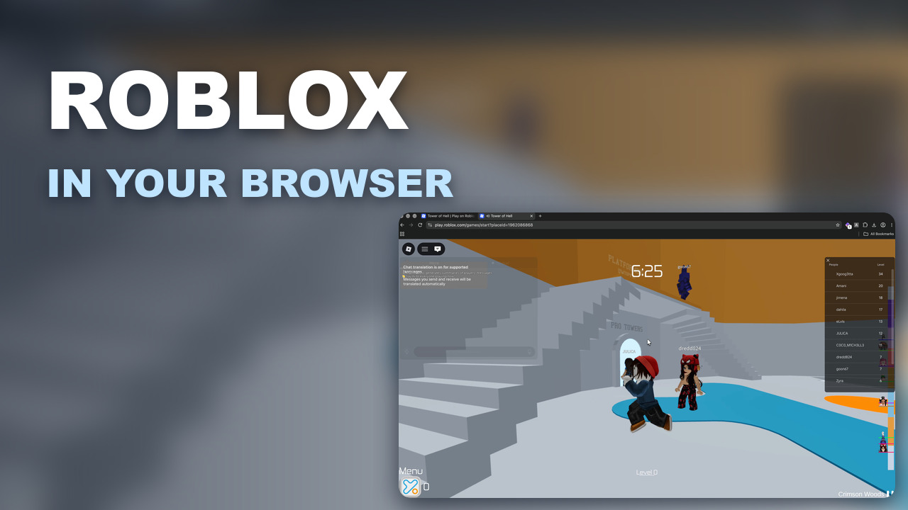

# Ajar

[](https://discord.gg/hUEmQgZXW8)
[](https://github.com/bzzimmy/ajar/releases/latest)
[](LICENSE)

Ajar brings any public Roblox game into your web browser, no desktop app required. It hooks into Roblox's official Web Play client, a WebAssembly build that's normally locked down to creators playtesting their own experiences. Your existing Roblox session handles auth and nothing leaves your machine.

[](https://www.youtube.com/watch?v=bayKbZ1_q-Q)

## Install

1. Download `ajar.zip` from the [latest release](https://github.com/bzzimmy/ajar/releases/latest) and unzip it.
2. Open `chrome://extensions`, enable **Developer mode**, and click **Load unpacked**.
3. Select the unzipped folder, then click the globe button (Play in browser) on any Roblox game page.

Works in Chrome and Chromium-based browsers.

## Support

Questions go in the [Discord](https://discord.gg/hUEmQgZXW8), bugs in [issues](https://github.com/bzzimmy/ajar/issues).

## Development

```sh
npm install
npm run lint
npm run format
```

## License

[MIT](LICENSE)
